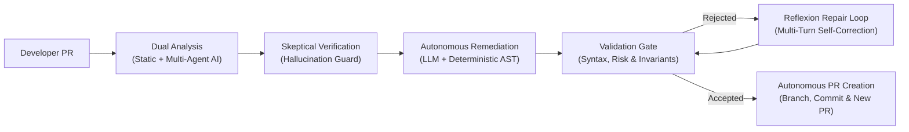
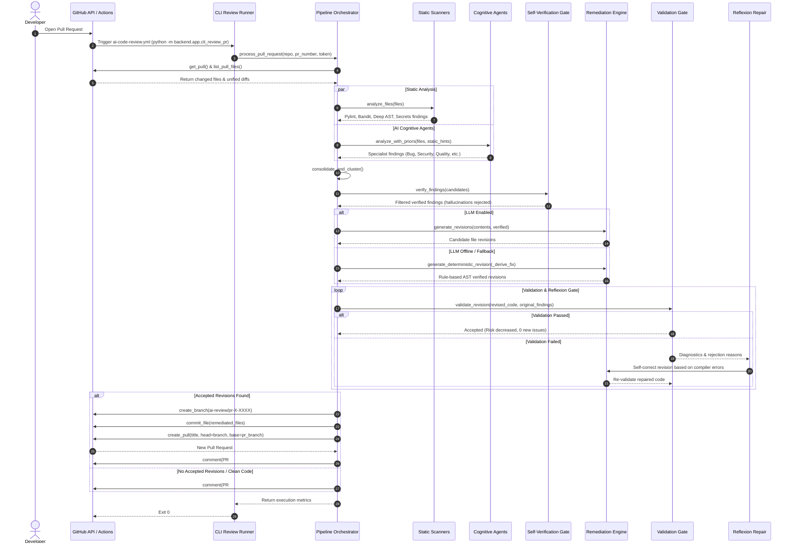

# 🛡️ CodeSentinel v2.0: Complete Architectural Specification & Working Manual

> **An In-Depth Engineering Manual for the Agentic AI-Based Risk-Adaptive and Self-Verifying Framework for Autonomous Code Review and Automated Code Revision.**

---

## 1. Executive Summary & Core Philosophy

### 1.1 The Industry Dilemma
Modern software development teams face two conflicting challenges in code review:
1. **Traditional Static Analysis Tools (SAST)**: Produce high volumes of alerts with significant false-positive rates, lack semantic and contextual awareness, and cannot remediate the problems they identify.
2. **First-Generation AI Code Review Bots**: Often hallucinate non-existent line numbers or functions, offer raw unchecked snippet suggestions, and leave the developer with the burden of manual editing and verification.

### 1.2 The CodeSentinel Solution
CodeSentinel is an **autonomous, risk-adaptive, and self-verifying pairing and remediation system**. Rather than merely posting comments, CodeSentinel implements a complete closed-loop cycle:

$$\text{PR Ingestion} \longrightarrow \text{Parallel Static + AI Analysis} \longrightarrow \text{Self-Verification Gate} \longrightarrow \text{Fix Generation} \longrightarrow \text{Validation Gate} \longrightarrow \text{New PR Opened}$$



### 1.3 Core Tenets
- **Never Complain Without Proposing a Solution**: Every verified bug or vulnerability must be accompanied by an actionable, verified fix.
- **Never Propose a Solution Without Proving It Works**: All fixes must pass an automated re-analysis validation gate and include companion regression unit tests.
- **Priors-Driven Cognition**: Compiler and linter facts are injected into LLM contexts as structured priors to eliminate hallucinations.
- **Zero-Failure Offline Guarantee**: When LLM APIs are offline or unconfigured, the deterministic AST remediation engine synthesizes verified fixes so pull request automation never stalls.
- **Non-Destructive Git Workflows**: Developer branches and original PRs are never modified directly; verified fixes are submitted as distinct, reviewable pull requests.

---

## 2. High-Level System Architecture

CodeSentinel is organized into a modular layered architecture separating the analysis engine, remediation pipeline, governance systems, and presentation layers:

```mermaid
flowchart TD
    subgraph Input_Layer ["1. Ingestion Layer"]
        PR["GitHub PR Event"]
        CLI["Autonomous CLI Runner"]
        WEB["Interactive Web UI"]
        API["FastAPI REST / SSE Stream"]
    end

    subgraph Analysis_Layer ["2. Dual-Engine Analysis Layer"]
        direction TB
        subgraph Static_Engines ["Static Scanners"]
            Pylint["Pylint Linter"]
            Bandit["Bandit AST Security"]
            Radon["Radon Complexity & MI"]
            DeepAST["Deep AST Rule Engine"]
            Secrets["High-Entropy Secret Scanner"]
            SCA["Software Composition (CVEs)"]
        end
        subgraph AI_Engines ["7 Specialist LLM Agents"]
            BugAgent["Bug Detection Agent"]
            SecAgent["Security Analysis Agent"]
            QualAgent["Code Quality Agent"]
            RefactorAgent["Refactoring Agent"]
            PerfAgent["Performance Agent"]
            TestAgent["Testability Agent"]
            ArchAgent["Architecture Agent"]
        end
    end

    subgraph Consolidation_Layer ["3. Consolidation & Risk Engine"]
        Cluster["Semantic & Line Clustering"]
        RiskCalc["Risk Index (0-100) & Posture (A+ to F)"]
        Taxonomy["CWE & OWASP Taxonomy Mapping"]
    end

    subgraph Verification_Layer ["4. Skeptical Self-Verification"]
        Verifier["Independent Verification Agent"]
        AdaptiveThresh["Adaptive Risk-Weighted Thresholding"]
    end

    subgraph Remediation_Layer ["5. Autonomous Remediation & Validation"]
        FixGen["LLM Fixer Agent"]
        DetAST["Deterministic AST Engine (_derive_fix)"]
        ValGate["Automated Validation Gate"]
        Reflexion["Reflexion Self-Repair Loop"]
        TestGen["Pytest Companion Generator"]
    end

    subgraph Execution_Layer ["6. GitHub Automation & Governance"]
        BranchMgr["Branch Creator (ai-review/pr-X-XXXX)"]
        CommitMgr["File Committer"]
        PRMgr["Pull Request Creator"]
        SARIF["OASIS SARIF v2.1.0 Exporter"]
        PolicyGate["Enterprise Policy Engine"]
    end

    Input_Layer --> Analysis_Layer
    Static_Engines -- "Static Priors" --> AI_Engines
    Analysis_Layer --> Consolidation_Layer
    Consolidation_Layer --> Verification_Layer
    Verification_Layer --> Remediation_Layer
    Remediation_Layer --> Execution_Layer
```



---

## 3. End-to-End Execution Sequence

The diagram below details the exact chronological sequence executed when a Pull Request is analyzed:



---

## 4. Deep-Dive: Stage-by-Stage Operational Pipeline

### 4.1 Stage 1: Ingestion & Input Preprocessing
- **Module**: `backend/app/engine/analysis.py`, `backend/app/services/github_client.py`
- **Diff Ingestion**: Extracts unified diff patches via GitHub API.
- **Line Offset Tracking**: Reads `@@ -old,len +new,len @@` unified-diff headers via `changed_lines_from_patch` to map only the lines modified by the developer.
- **Language Filtering**: Filters non-Python files into `skipped_files` while preserving them in the audit log.
- **Syntax Check**: Performs preliminary `ast.parse()` to catch existing syntax errors before multi-agent processing.

### 4.2 Stage 2: Static & Deep AST Analysis
- **Module**: `backend/app/scanners/static_analysis.py`, `backend/app/scanners/secret_scanner.py`, `backend/app/scanners/sca.py`
Executes six parallel scanners:
1. **Pylint**: Formats compiler diagnostics (C, R, W, E, F) into structured findings.
2. **Bandit**: Scans for common security flaws (e.g. B307 eval, B602 shell=True, B404 subprocess).
3. **Radon**: Computes Cyclomatic Complexity (CC) and Maintainability Index (MI).
4. **Deep AST Engine (`_AstChecker`)**:
   - **SQL Injection**: Detects dynamic string formatting/f-strings in `cursor.execute()` or ORM `.raw()`.
   - **Command Injection**: Identifies `subprocess.Popen/run/call` with `shell=True`.
   - **Unsafe Deserialization**: Flags `pickle.loads()` and `_pickle.loads()`.
   - **Missing Timeouts**: Identifies `requests` and `httpx` HTTP calls lacking explicit `timeout=...`.
   - **Relative Imports Beyond Top Level**: Detects invalid `from .` or `from ..` beyond package bounds.
   - **Mutable Default Arguments**: Detects `def func(cache={})` or `def func(items=[])`.
   - **Bare Exceptions**: Flags `except:` and swallowed `pass` blocks.
5. **High-Entropy Secret Scanner**:
   - Computes Shannon entropy on string literals.
   - Matches regex patterns for AWS Access Keys (`AKIA[0-9A-Z]{16}`), OpenAI keys (`sk-[a-zA-Z0-9]{48}`), GitHub PATs (`ghp_[a-zA-Z0-9]{36}`), Stripe secrets (`sk_live_[0-9a-zA-Z]{24}`), and RSA private keys.
6. **Software Composition Analysis (SCA)**:
   - Scans dependency manifests (`requirements.txt`).
   - Identifies vulnerable packages and generates CycloneDX v1.5 JSON SBOMs.

### 4.3 Stage 3: Multi-Agent Cognitive Pipeline with Static Priors
- **Module**: `backend/app/engine/agents.py`, `backend/app/engine/llm.py`
To eliminate LLM hallucinations, static findings from Stage 2 are compiled into structured **Prior Hints**:
```
File Context: server.py
[Prior Compiler Diagnostic]: Line 4: Bandit B307 (Use of eval detected)
[Prior Compiler Diagnostic]: Line 8: AST-SHELL-TRUE (Subprocess called with shell=True)
[Prior Linter Diagnostic]: Line 12: Pylint bare-except (Bare except hides all errors)
```
Seven specialized agents evaluate the code concurrently:
- Each agent receives system instructions tailored to its domain (e.g. Security Agent focuses strictly on OWASP Top 10, CWE taxonomy, and exploit vectors).
- The static priors direct the LLMs to analyze root causes and adjacent logical flaws rather than hallucinating new lines.

### 4.4 Stage 4: Consolidation & Deduplication
- **Module**: `backend/app/engine/consolidation.py`
Static tools and AI agents frequently flag the exact same defect. The consolidation engine clusters findings using:
- **Proximity Window**: Flags within $\pm 3$ lines on the same file are evaluated for semantic equivalence.
- **Rule & Category Alignment**: Combines static findings (e.g., Bandit B307) and AI findings (e.g., "Unsafe dynamic evaluation of user query") into a unified finding.
- **Source Merging**: Sets `sources = ["ast", "bandit", "ai"]`, ensuring corroboration evidence is recorded.

### 4.5 Stage 5: Risk Scoring & CWE/OWASP Taxonomy
- **Module**: `backend/app/engine/risk.py`, `backend/app/utils/cwe_mapping.py`
- **Quantitative Risk Formula**:
  $$\text{Severity Weight} \times \text{Category Weight} \times \text{Confidence} \times \text{Blast Radius Weight}$$
  Weights: Critical ($1.0$), High ($0.75$), Medium ($0.5$), Low ($0.25$), Info ($0.1$).
- **Overall Posture Grade**:
  - $0-15$: Grade **A+** (Exemplary)
  - $16-30$: Grade **A** (Secure)
  - $31-50$: Grade **B** (Moderate Risk)
  - $51-70$: Grade **C** (High Risk)
  - $71-85$: Grade **D** (Severe Risk)
  - $86-100$: Grade **F** (Critical Vulnerabilities)
- **Taxonomy Mapping**: Maps every finding to its official **CWE ID** (e.g. CWE-89, CWE-78, CWE-95, CWE-691), OWASP Top 10 classification, and remediation effort.

### 4.6 Stage 6: Skeptical Self-Verification Gate
- **Module**: `backend/app/engine/verifier.py`
An independent verification module inspects every finding before it is presented:
1. **Existence Verification**: Verifies that `finding.line` exists in the file.
2. **Snippet Matching**: Confirms the code snippet appears in the target file.
3. **Adaptive Thresholding**:
   $$\text{Threshold} = 0.5 + 0.3 \times \left(\frac{\text{Risk}}{100}\right)$$
   High-risk repositories require higher verification confidence to avoid disruption.
4. **Status Classification**: Findings are categorized into `verified`, `uncertain`, or `rejected`. Only `verified` findings advance to the automated remediation engine.

### 4.7 Stage 7: Autonomous Fix Generation & Deterministic Fallback
- **Module**: `backend/app/remediation/fixer.py`
CodeSentinel utilizes a dual-engine architecture for generating fixes:
1. **Primary LLM Fixer Agent**: Generates a complete rewrite of the target file resolving all verified defects while maintaining idioms and coding standards.
2. **Deterministic AST Engine (`_derive_fix`)**: If LLM APIs are offline, rate-limited, or unconfigured, the deterministic engine synthesizes verified fixes:
   - **`eval(x)`**: Replaced with `ast.literal_eval(x)` and injects `import ast`.
   - **`shell=True`**: Replaced with `shell=False`.
   - **`relative-beyond-top-level`**: Replaced with absolute imports or dual-import try/except fallback blocks.
   - **Mutable Defaults (`={}` / `=[]`)**: Replaced with `=None` default arguments.
   - **Bare Except**: Replaced with `except Exception as err:`.
   - **Swallowed Exceptions**: Injects `logging.exception(...)` and `import logging`.
   - **Leaked Secrets**: Replaced with `os.getenv(...)` and injects `import os`.
3. **Companion Test Suite Generation**: Synthesizes a companion `pytest` suite for every revision, asserting syntax validity and verifying that vulnerable symbols are absent.

### 4.8 Stage 8: Automated Validation Gate & Reflexion Self-Repair
- **Module**: `backend/app/remediation/revalidation.py`
Every proposed revision is written to an isolated temporary sandbox and re-analyzed:
- **Condition 1 (Syntax Check)**: Must pass `ast.parse()`.
- **Condition 2 (Target Resolution)**: All originally targeted defects must no longer be present.
- **Condition 3 (Zero Side-Effects)**: Re-scanning the fixed code must introduce $0$ new verified defects (`max_new_issues = 0`).
- **Condition 4 (Strict Risk Drop)**: $\text{Risk}_{\text{after}} < \text{Risk}_{\text{before}}$.

**The Reflexion Repair Loop**:
If any condition fails, CodeSentinel triggers an automated reflexion repair loop (up to `max_fix_retries = 2`), providing the model with the exact compiler errors and validator feedback to self-correct.

### 4.9 Stage 9: Pull Request Automation Engine
- **Module**: `backend/app/engine/pipeline.py`, `backend/app/services/github_client.py`
When accepted revisions are available:
1. Computes target branches (`head_ref` with fallback to `base_ref`).
2. Creates an isolated branch: `ai-review/pr-{pr_number}-{uuid4().hex[:6]}`.
3. Commits the remediated files with descriptive commit messages via GitHub Contents API.
4. Opens a **NEW Pull Request** titled `🤖 Automated Security & Bug Fixes for #{pr_number}`.
5. Injects a structured markdown diff, risk reduction metrics, and problem/solution summaries into the new PR body.
6. Posts a comprehensive review report and a direct link to the new revision PR on the developer's original pull request.
7. Ignores bot-created branches (`ai-review/*`) to prevent recursive execution loops.

---

## 5. Walkthrough of Real-World Execution: PR #2 → PR #3

To observe the platform in production, consider the execution on pull request **PR #2 (`Hemanthk7504-patch-1`)**:

### Step 1: Developer PR #2 Diff
The developer submitted changes in `backend/main.py`:
```python
"""Backend root entrypoint proxying to backend.app.main."""
from .app.main import app
from main import main

__all__ = ["app"]
```

### Step 2: CodeSentinel Inspection Output
```json
{
  "files": 1,
  "summary": {
    "files_analyzed": 1,
    "total_findings": 2,
    "verified": 2,
    "overall_risk": 71.96,
    "posture_grade": "D",
    "cwe_counts": {
      "CWE-691": 1
    },
    "top_risks": [
      "HIGH: relative-beyond-top-level: Attempted relative import beyond top-level package [CWE-691] at backend/main.py:2"
    ]
  }
}
```

### Step 3: Autonomous Remediation & Validation
1. `_derive_fix` recognized the relative import beyond top-level package (`CWE-691`) and unused import.
2. The engine generated the following remediated file:
   ```python
   """Backend root entrypoint proxying to backend.app.main."""
   try:
       from backend.app.main import app
   except ImportError:
       from app.main import app
   # Removed unused import: from main import main

   __all__ = ["app"]
   ```
3. Validation gate confirmed:
   - **Issues resolved**: 2 / 2 (100% resolution ratio).
   - **New issues**: 0.
   - **Risk score**: Dropped from `71.96` to `0.0`.
   - **Validation status**: `✅ accepted`.

### Step 4: Autonomous Pull Request Creation
- **Branch created**: `ai-review/pr-2-766067`
- **Revision PR opened**: **[PR #3: 🤖 Automated Security & Bug Fixes for #2](https://github.com/Hemanthk7504/Code_review/pull/3)**
- **Original PR #2 comment posted**:
  > `🤖 A revision PR with verified fixes was opened: https://github.com/Hemanthk7504/Code_review/pull/3`

---

## 6. Enterprise Governance, Security & Quality Gates

### 6.1 Authentication & Role-Based Access Control (RBAC)
- **JWT Cryptography**: Uses HS256 JWT tokens with configurable expiration (`jwt_access_token_expire_minutes: 1440`).
- **Password Security**: Passlib PBKDF2-SHA256 password hashing.
- **Roles & Permissions**:
  - `Admin`: Full access, policy creation, user administration.
  - `Reviewer`: Submit reviews, run revisions, view reports.
  - `Auditor`: Read-only access to audit logs, compliance scorecards, and SARIF exports.
- **Dual Authentication**: API endpoints accept either `Authorization: Bearer <JWT>` or `X-API-Key: <KEY>`.

### 6.2 Enterprise Policy Engine & Quality Gates
- **Module**: `backend/app/services/policy_engine.py`
Quality gates allow engineering leaders to define pass/fail enforcement rules:
```json
{
  "name": "Production Gate",
  "block_on_critical": true,
  "max_overall_risk": 25.0,
  "max_high_severity": 0,
  "require_ast_verification": true,
  "disallow_unpinned_deps": true
}
```
If a review fails the policy evaluation, `/api/v1/policies/evaluate` returns `passed: false` and blocks merges in CI/CD pipelines.

### 6.3 Regulatory Compliance Scorecards
- **Module**: `backend/app/services/compliance.py`
Maps repository findings to enterprise regulatory frameworks:
- **OWASP Top 10 (2021)**: A01 Broken Access Control, A02 Cryptographic Failures, A03 Injection, etc.
- **PCI-DSS v4.0**: Requirement 6 (Develop and Maintain Secure Systems and Software).
- **SOC 2 Type II**: Trust Services Criteria (CC6.1, CC6.6, CC7.1).
- **HIPAA Security Rule**: 45 CFR § 164.312 (Technical Safeguards).

---

## 7. Verification & Automated Test Suite

CodeSentinel maintains a 100% automated test pass rate across 41 unit, integration, and security tests.

```bash
python -m pytest tests/ -v
```

### Test Suite Structure
| Test File | Test Count | Description |
|---|---|---|
| `tests/test_core.py` | 11 | Ingestion, AST patch parsing, consolidation, risk scoring, simulated LLM loops, validation rejection gates, and webhook signatures. |
| `tests/test_advanced.py` | 7 | High-entropy secrets scanner, deep AST rules (SQLi, shell=True, pickle, timeouts), CWE taxonomy, posture grading, and OASIS SARIF v2.1.0 compliance. |
| `tests/test_backend_structure.py` | 2 | Clean separation between `backend/` and `frontend/`, and backward-compatible module aliasing. |
| `tests/test_integrations_and_advanced.py` | 6 | SCA dependency scanner, CycloneDX SBOM generator, enterprise quality gates, compliance scorecards, and SSE real-time streaming. |
| `tests/test_jwt_auth.py` | 11 | JWT lifecycle, pre-seeded accounts, RBAC enforcement, password changes, and dashboard authentication guards. |
| `tests/test_pr_review.py` | 4 | Pull request defect detection, auto-revision PR creation, bot loop avoidance (`ai-review/*`), CLI runner execution, and offline import fix synthesis. |

---

## 8. Summary of Operational Commands

### Launching the Application
```bash
# Start the backend and web portal
python -m uvicorn backend.main:app --host 127.0.0.1 --port 8000 --reload
```

### Running the Test Suite
```bash
# Run all 41 unit and integration tests
python -m pytest tests/ -v
```

### Executing an Autonomous PR Review via CLI
```bash
# Reviews a GitHub PR, detects defects, and opens an auto-revision PR
python -m backend.app.cli_review_pr \
  --repo <owner/repo> \
  --pr <pr_number> \
  --token <github_token>
```
